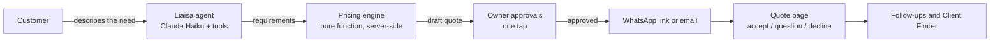

<p align="center">
  
</p>

<p align="center"><strong>The AI liaison between a small business and its customers.</strong><br>
Every enquiry answered. Every quote yours to approve.</p>

<p align="center">
  <a href="https://liaisa.co.in">Live app</a> ·
  <a href="https://liaisa.co.in/b/mehfil-kitchen/enquire">Try the demo enquiry</a> ·
  <a href="docs/ARCHITECTURE.md">Architecture</a> ·
  <a href="docs/PROMPTS.md">How it was built</a>
  <a href="https://drive.google.com/drive/folders/1JqGb3bK0xnVFK_3NkAJzOu9Tb-d31Fx-?usp=sharing">Artifacts</a>
</p>

Built for the **GoDaddy Inclusive Innovation Hackathon 2026** with Claude and GoDaddy Node.js hosting.

---

## What Liaisa does

A *liaison* connects two sides and keeps both informed. Liaisa does that for a small business and its customers, with AI in the middle of the connection (Li**ai**sa).

1. **A customer describes what they need** in their own words, on a link or QR code the business shares.
2. **Liaisa (Claude) works out the details and asks only what is missing**: at most two questions, at most four AI requests per enquiry.
3. **The server calculates the quote.** The AI never writes a price. A pure pricing function applies the owner's price list, minimums, weekend surcharge, travel fee, discount and tax.
4. **The owner approves in one tap.** An approvals inbox shows each enquiry with its total and any warnings. Quotes can also be approved from a signed one-tap email link, or read aloud with the voice briefing.
5. **The quote goes out by WhatsApp or email**, whichever the customer prefers. The customer accepts, asks a question or declines on a simple quote page.
6. **Quotes don't go cold.** Liaisa flags quotes with no reply and drafts the reminder. The owner sends it.
7. **Client Finder helps the business grow.** It suggests past customers to reconnect with, and uses Claude's web search to suggest organisations that could become new customers, with a source link for every lead. The owner approves every message.

Nothing reaches a customer without the owner's approval, unless the owner turns on the optional auto-approve setting for clean quotes (off by default).

### How you can tell what is AI

Every AI-written element (the assistant's questions, the summaries, drafted messages, discovered leads) carries a small ✦ sparkle. Forms, fixed rules and server-calculated amounts are labelled as such.

---

## Try it

| What | Where |
|---|---|
| Live app | https://liaisa.co.in |
| Demo customer enquiry (Mehfil Kitchen, a fictional caterer) | https://liaisa.co.in/b/mehfil-kitchen/enquire |
| Create your own business and see the owner side | https://liaisa.co.in/signup |
| Owner login | https://liaisa.co.in/owner/login |

**For judges:** you can create your own business at `/signup` with any email and see the whole owner experience (approvals, setup, share link and QR code, Client Finder). Demo owner credentials for the Mehfil Kitchen business are in the submission form, not in this repository.

> This is a demo environment. Data is kept in memory and resets when the app restarts or is redeployed.

---

## How it works



- **Claude extracts and asks, the server prices, a human approves.** The agent has two tools (`calculate_estimate`, `finish_intake`). The server recomputes every estimate itself and never trusts model totals.
- **Guardrails are code, not prompts:** request caps per enquiry and per day, a global AI daily cap, link and currency stripping in drafted messages, a 7-day no-repeat contact rule, do-not-contact flags, and validated structured output.
- **Models:** Claude Haiku 5.5 for intake and drafting, and Claude's web search tool for lead discovery. A typical enquiry costs a fraction of a cent. See `npm run eval` for the measured cost.

### Multi-business

Each business has its own owner login, services, prices, enquiries, quotes, leads and share link (`/b/<slug>/enquire`). Every repository is scoped by business, and tests check that one owner can never read another's data.

---

## Tech stack

Node.js 22 · Express · EJS · zod · nodemailer · helmet · express-rate-limit · express-session · bcryptjs · `@anthropic-ai/sdk` · qrcode. Hosted on GoDaddy Node.js hosting with the domain `liaisa.co.in`, HTTPS, and a Titan mailbox.

Fonts (Young Serif, Figtree) are self-hosted. There are no inline scripts or styles, and the Content Security Policy is strict.

---

## Run it locally

```bash
git clone https://github.com/ShreyaHolla/liaisa.git
cd liaisa
npm install
cp .env.example .env        # then edit .env (see below)
npm run dev                 # http://localhost:3000
```

With no API key set, Liaisa runs with a deterministic mock AI, so you can explore everything offline.

| Command | What it does |
|---|---|
| `npm run dev` | Run with auto-reload, loading `.env` |
| `npm start` | Run in production mode |
| `npm test` | Run the full test suite (mock AI, no cost) |
| `npm run test:pricing` | Pricing engine tests with coverage (100% branch coverage) |
| `npm run eval` | Live evaluation of the agent against the real model (costs a few cents) |
| `npm run hash-password` | Generate an owner password hash |
| `npm run package` | Build the zip for GoDaddy hosting |

### Configuration

All settings are environment variables. `.env.example` lists the names with no values, and real values never go in the repository. Main groups:

- **AI:** `AI_ENABLED`, `AI_MODE` (`live` or `mock`), `ANTHROPIC_API_KEY`, `AI_MODEL_INTAKE`, `AI_MODEL_OUTREACH`, `AI_MODEL_DISCOVERY`, the `AI_PRICE_*` variables for cost logging, and the daily caps (`AI_GLOBAL_DAILY_CAP`, `CLIENT_DRAFT_DAILY_CAP`, `CLIENT_DISCOVERY_DAILY_CAP`).
- **Mail:** `MAIL_ENABLED`, `SMTP_HOST`, `SMTP_PORT`, `SMTP_USER`, `SMTP_PASS`, `MAIL_FROM`, `OWNER_EMAIL`.
- **App:** `BASE_URL`, `SESSION_SECRET`.
- **Owner login:** see below.

The AI key is required only when `AI_MODE=live` and `AI_ENABLED=true`. Mail settings are required only when `MAIL_ENABLED=true`.

### Owner login setup

1. Run `npm run hash-password` to generate a password hash.
2. Set `OWNER_PASSWORD_HASH` and `SESSION_SECRET` in `.env`. If your host mangles the `$` characters in the hash, set `OWNER_PASSWORD_HASH_B64` (the base64 of the hash) instead. It overrides the plain variable when set.
3. Set both the password and the session secret, or neither. With neither, `/owner/*` returns 503. With only one, the app refuses to start.

The demo owner logs in with `OWNER_EMAIL` and that password. Other businesses sign up at `/signup`.

---

## Security and privacy

- No secrets in the repository. `.env` is git-ignored, and host secrets are set on the server.
- Passwords are hashed with bcrypt. Owner routes use sessions with CSRF protection.
- Signed one-tap links are single-use, expire after 24 hours, are bound to one business and act only on POST.
- Strict CSP, security headers, rate limits on forms, sign-up, enquiries and AI calls, and output escaping.
- The AI never receives customer contact details, surnames, prices to invent, or links. Contact details and message text are kept out of logs.
- Outreach is always approved and sent by the owner, through their own email app or WhatsApp.

---

## Documentation

| File | Contents |
|---|---|
| [`docs/PRD.md`](docs/PRD.md) | Product requirements and scope |
| [`docs/ARCHITECTURE.md`](docs/ARCHITECTURE.md) | System architecture, flows, security and deployment |
| [`docs/DESIGN.md`](docs/DESIGN.md) | Design system and screens |
| [`docs/TestCases.md`](docs/TestCases.md) | Test plan |
| [`docs/openapi.yaml`](docs/openapi.yaml) | API specification |
| [`docs/PROMPTS.md`](docs/PROMPTS.md) | The prompts used to build this project with Claude Code |
| [`docs/Rules.md`](docs/Rules.md) | Budget, rules and spend log |
| [`CLAUDE.md`](CLAUDE.md) | Project memory for Claude Code |

---

## Built with Claude

Liaisa was designed and built in a few days with Claude and Claude Code. The prompts, decisions and reports from each milestone are logged in [`docs/PROMPTS.md`](docs/PROMPTS.md), and the spend against the hackathon budget is tracked in [`docs/Rules.md`](docs/Rules.md).

## Known limits and next steps

- **Data is in memory** and resets on restart. MySQL repositories are specified in the architecture and are the next step.
- **Outbound email from the hosting environment** may be blocked. The contact form saves every message and shows it, with its delivery status, on the owner's Messages page.
- **WhatsApp is click-to-chat:** the owner taps send. Automatic WhatsApp messages need the WhatsApp Business Platform, which is paid.
- **Not yet built:** email verification, password reset, payments, custom domains per business, automatic follow-up scheduling, approving quotes from WhatsApp.

## License

All rights reserved for now. A licence will be added after the hackathon.
